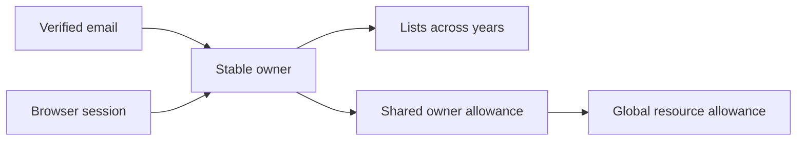
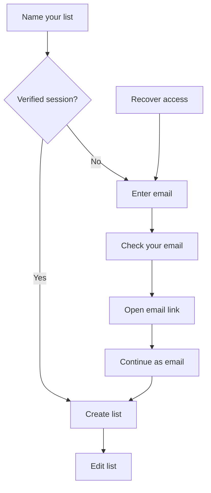

# Email access

This feature is reviewed in three dependent changes: ownership and usage
primitives, verification and delivery, then the signup/recovery interface.
Deploy only the completed stack after review and merge into the default branch.



Owners gain a unique verified email. Existing sessions remain anonymous until
explicit verification; adding an email to an owner never upgrades an old session.
Existing list URLs and content are preserved.

| Resource | Per owner | Global |
| --- | ---: | ---: |
| New lists / UTC day | 10 | 30 |
| Image attempts / UTC day | 50 | 300 |
| Reserved image bytes / UTC day | 125 MB | 750 MB |
| Reserved image storage | 500 MB | 5 GB |
| Image reads / UTC day | — | 10,000 |

Images remain limited to 2 MiB each. Lists hold up to 200 gifts; owners hold up
to 100 lists. Existing content above a limit stays available. MB/GB are decimal;
MiB is binary. Lifetime reservations do not reset on deletion or failure.

The additive migration initializes owner image reservations from existing image
references at the maximum image size. Existing global reservations are retained.
Ownership transfers must also transfer usage; sign-in does not reset counters.

Conditional reservations and assertions run in one D1 batch. A failed condition
aborts the entire batch, including other counters. External operations only run
after successful reservation. The first change adds these primitives without
enabling email sign-in or increasing existing global operation limits.

## Verification and delivery

```mermaid
sequenceDiagram
  participant Browser
  participant Worker
  participant D1
  participant Email as Email provider
  Browser->>Worker: List name, email, request key
  Worker->>D1: Reserve request allowance; save intent and encrypted email
  Worker->>Email: Send with stable delivery identifier
  Email-->>Browser: Link containing proof in URL fragment
  Browser->>Worker: Inspect proof (no consumption)
  Browser->>Worker: Explicit Continue
  Worker->>D1: Consume proof, reserve list allowance, create list and session
  Worker-->>Browser: Verified cookie and list destination
```

A proof expires after 30 minutes and is stored as a hash. Pending email payloads
are AES-GCM encrypted, retried at most three times within 20 minutes, and erased
on acceptance or terminal failure. Provider attempts reserve 90/day and
2,500/calendar month globally, including retries. Requests are limited per
recipient (one/minute, three/hour, ten/day), per source (ten/hour, thirty/day),
and globally (180/day). Request identity is independent of email delivery, so
retrying a response does not duplicate a list. Resending replaces the proof and
invalidates the old link. Confirmation is transactional and consumes proof only
once. If list creation cannot complete, no session or list is partially created.
An empty verified owner can remain after a list-capacity failure.

The link establishes access only in the browser that confirms it. There is no
polling or automatic grant to the browser that merely supplied the email.
The verified cookie is separate from existing anonymous cookies. Ordinary edits
remain available to legacy sessions; new lists and images require verification.
An explicit claim requires the anonymous session proof at request time and again
checks its validity at confirmation. Lists and usage transfer together, and old
anonymous sessions are revoked. Public list data never includes email addresses.

The canonical application origin is configuration, not a request Host header.
Tokens are sent in URL fragments and JSON bodies, not URL query parameters.
Email matching trims and lowercases; it does not remove plus tags or dots.

## Local development

The default environment uses `EMAIL_MODE=capture` and simulated D1/R2. It does not
send email or require production credentials. On loopback only, `/api/local/mail`
returns the latest captured messages. The production environment cannot expose
this endpoint. Expired request records are removed after a one-day retention
period. The two-minute scheduled handler retries pending deliveries and cleans
expired records.

## Release setup

1. Review and merge the complete feature stack into `main`. Resolve the existing
   default-branch release-check update before deploying: `npm run deploy` must
   compare HEAD with freshly fetched `origin/main`.
2. Verify the sender domain, SPF/DKIM and DMARC in Resend. Keep tracking disabled.
3. Add a Resend webhook for `email.bounced` and `email.complained` targeting
   `https://gimmesomefreakingpresents.com/api/email/events`. Save its signing secret.
4. During the explicitly authorized release, install `RESEND_API_KEY`,
   `RESEND_WEBHOOK_SECRET`, and `EMAIL_ENCRYPTION_KEY` as Worker secrets. The
   encryption key is a cryptographically random 32-byte value encoded as base64.
   Preserve it through retries; rotating it invalidates pending encrypted emails.
   Use the provider dashboard or interactive Wrangler secret prompts; never put
   values in source, command arguments, PRs, or logs. Secret writes can publish
   configuration and belong to release preparation, not routine local setup.
5. Back up D1 and apply migrations 0005 and 0006 once, in order. Existing owner
   reservations are initialized conservatively; historical global usage is kept.
6. Deploy the clean, reviewed `origin/main` commit with `npm run deploy`. Confirm
   the two-minute scheduled trigger is active and the production email mode is
   `resend`.
7. With authorized test recipients, check inbox placement and SPF/DKIM/DMARC
   results. Verify signup, recovery in a fresh browser, a second list, expired
   links, and bounce-event processing. Production delivery is not established by
   local capture tests.

Imported records with no email mapping remain public and require a separate
trusted mapping for recovery. A public URL or list name does not grant ownership.
AI features are not enabled by this work; future metered operations must reserve
owner and global allowances before calling a provider.

## Interface



The list-name screen keeps the existing appearance. Verification adds an email
step, a waiting state with resend/address correction, and an explicit confirmation
page. A link opened on another device grants access only on that device. The
original tab does not poll. There is no account dashboard or list-history screen;
recovery returns to the requested owned list or the most recently updated list.
The home page offers recovery and an explicit option to switch email identities.
Daily-limit feedback formats the reset time using the browser's local timezone.
Email pages use `/auth/access` and `/auth/recover` so existing single-segment
public list URLs remain available, including lists named `access` or `recover`.

Address correction invalidates the earlier pending proof. Opening a different
link in the same tab resets confirmation state. Failed requests preserve entered
fields, and expired or used links offer a route to request fresh access.
