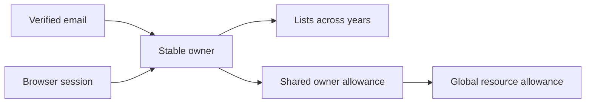

# Email access

This feature is reviewed in three dependent changes: ownership and usage
primitives, verification and delivery, then the signup/recovery interface.
Deploy only the completed stack after review and merge into the default branch.

Owners gain a unique verified email. Existing sessions remain anonymous until
explicit verification; adding an email to an owner never upgrades an old session.
Existing list URLs and content are preserved.

| Resource | Per owner | Global |
| --- | ---: | ---: |
| New lists / UTC day | 10 | 30 |
| Image attempts / UTC day | 50 | 300 |
| Reserved image bytes / UTC day | 125 MB | 750 MB |
| Reserved image storage | 500 MB | 5 GB |
| Image reads / UTC day | — | 10,000 |

Images remain limited to 2 MiB each. Lists hold up to 200 gifts; owners hold up
to 100 lists. Existing content above a limit stays available. MB/GB are decimal;
MiB is binary. Lifetime reservations do not reset on deletion or failure.

The additive migration initializes owner image reservations from existing image
references at the maximum image size. Existing global reservations are retained.
Ownership transfers must also transfer usage; sign-in does not reset counters.

Conditional reservations and assertions run in one D1 batch. A failed condition
aborts the entire batch, including other counters. External operations only run
after successful reservation. The first change adds these primitives without
enabling email sign-in or increasing existing global operation limits.
